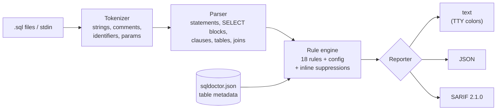

# sql-query-doctor

[](https://github.com/s78519300-creator/sql-query-doctor/actions/workflows/ci.yml)
[](https://www.python.org/)
[](LICENSE)

**A linter for slow SQL.** `sqldoctor` reads your `.sql` files, finds the
query patterns that make analytics databases crawl, and tells you *why* each
one is slow and *how* to rewrite it. It ships with ClickHouse-specific rules
(partition pruning, `FINAL`, hash-join sides, `GLOBAL IN`, Nullable columns),
runs fully offline, and has zero dependencies.

```bash
pip install git+https://github.com/s78519300-creator/sql-query-doctor
sqldoctor check queries/*.sql --config sqldoctor.json
```

## Why

Most slow queries I've debugged weren't exotic. They were the same dozen
mistakes over and over: a `toDate(ts) = ...` that silently disables partition
pruning, a four-billion-row table on the right side of a hash join, a
`ReplacingMergeTree` read without `FINAL` that double-counts revenue, an
`ALTER TABLE ... DELETE WHERE 1 = 1` sitting in a runbook. Each of these is
obvious *once you know to look*, and all of them can be caught before the
query ever reaches production.

Working through 100+ diagnostic queries on a ClickHouse cluster, fixing these
patterns cut query time by about 35%. `sqldoctor` is that review checklist
turned into a tool, so it runs on every pull request instead of after an
incident.

## Features

- **18 rules** covering scans, indexes, joins, deduplication, NULL semantics and
  pagination. Each finding has a specific message, a source excerpt with a
  caret, and a concrete fix.
- **Token-based, not regex-based.** A real tokenizer handles strings, quoted
  identifiers, comments and query parameters, so `'SELECT * FROM x'` inside a
  string literal or `LIKE '%x'` inside a comment never triggers a finding.
- **Structure-aware.** Clauses are matched per query block and paren depth, so
  `ORDER BY` inside `OVER (...)` or `FROM` inside `extract(YEAR FROM ts)` isn't
  mistaken for a clause, and subqueries, CTEs and `UNION`s are analysed
  separately.
- **Schema-aware when you want it.** Declare row counts, engines, partition
  and sorting keys in a JSON config and the metadata rules light up: missing
  partition filters, large right-hand joins, missing `FINAL`, distributed
  subqueries.
- **Three output formats:** colored terminal output (plain when piped or with
  `NO_COLOR`), JSON for scripts, and SARIF 2.1.0 for GitHub code scanning.
- **CI friendly:** exit code `1` when findings reach `--fail-on` (default
  `error`), `2` for usage or config errors; inline suppressions for the
  queries you've decided to keep.
- **Pure standard library**, Python 3.9+.

## Sample output

Real output from `sqldoctor check examples/*.sql --config examples/sqldoctor.json`
(trimmed to two of the six files; the exit code is 1 because of the errors):

```text
examples/03_support_search.sql
  5:8     warning  SQD001  SELECT * reads every column of analytics.events
    5 | SELECT *
      |        ^
      = fix: List only the columns you need. In ClickHouse, SELECT * EXCEPT (...) is still a full read of
             the remaining columns.

  8:21    warning  SQD004  LIKE '%/checkout/error%' has a leading wildcard and cannot use an index
    8 |   AND page_url LIKE '%/checkout/error%'
      |                     ^
      = fix: Anchor the pattern ('error%'), search for whole tokens with hasToken(), add an ngrambf_v1 /
             tokenbf_v1 skip index, or store reverse(col) for suffix searches.

  9:8     info     SQD006  3 OR-ed equality checks on `event_type` can be written as event_type IN (...)
    9 |   AND (event_type = 'page_view' OR event_type = 'error' OR event_type = 'js_exception')
      |        ^
      = fix: Rewrite as col IN (1, 2, 3).

  10:15   warning  SQD009  NOT IN (subquery) returns no rows if the subquery yields a NULL
   10 |   AND user_id NOT IN (SELECT user_id FROM analytics.internal_users)
      |               ^
      = fix: Use NOT EXISTS (correlated), a LEFT ANTI JOIN in ClickHouse, or add WHERE col IS NOT NULL to
             the subquery.

  11:1    info     SQD007  ORDER BY without LIMIT sorts the entire result
   11 | ORDER BY event_time DESC;
      | ^
      = fix: Add a LIMIT, sort on the client if the result is small, or drop the ORDER BY from
             subqueries. Grouped queries are not reported because their output is normally small.

examples/05_cluster_rollup.sql
  8:17    warning  SQD017  IN (subquery) over Distributed tables runs on every shard; use GLOBAL IN
    8 |   AND e.user_id IN (
      |                 ^
      = fix: Use GLOBAL IN / GLOBAL JOIN, or co-locate the data by sharding key and keep the local form
             intentionally (set distributed_product_mode).

  11:48   error    SQD014  `= NULL` is never true; use IS NULL
   11 |       WHERE plan = 'enterprise' AND churned_at = NULL
      |                                                ^
      = fix: Use x IS NULL / x IS NOT NULL (isNull(x) / isNotNull(x) in ClickHouse), or
             isNotDistinctFrom(a, b) for NULL-safe equality.

  17:6    warning  SQD003  `analytics.page_views` is scanned without WHERE/PREWHERE
   17 | FROM analytics.page_views
      |      ^
      = fix: Add a filter on the partition key or the leading sorting-key columns. If you really need
             every row, aggregate in a materialized view instead of scanning on every request.

  17:6    warning  SQD016  `analytics.page_views` is partitioned by toDate(viewed_at) but there is no filter on viewed_at
   17 | FROM analytics.page_views
      |      ^
      = fix: Add a predicate on the partition column (e.g. event_date >= today() - 7) in WHERE or
             PREWHERE, using the raw column so the pruning can kick in.

  19:18   info     SQD018  OFFSET 50,000 reads and discards 50,000 rows per page
   19 | LIMIT 100 OFFSET 50000;
      |                  ^
      = fix: Use keyset pagination: remember the last sort key you returned and query WHERE (ts, id) <
             (last_ts, last_id) ORDER BY ts DESC, id DESC LIMIT 100.

Found 23 problems (4 errors, 14 warnings, 5 info) in 6 files.
```

Note what is *not* reported in
`03_support_search.sql`: its second query selects the string
`'SELECT * FROM x WHERE y = NULL'`, and the block comment at the top contains a
`LIKE '%ignored%'`. Both are invisible to the rules because they never look at
raw text.

## Usage

```bash
sqldoctor check queries/                       # directories are searched for *.sql
sqldoctor check "queries/**/*.sql"             # globs work on every OS
sqldoctor check - < adhoc.sql                  # read from stdin
sqldoctor check queries/ --format json         # machine-readable
sqldoctor check queries/ --format sarif -o sqldoctor.sarif
sqldoctor check queries/ --fail-on warning     # stricter CI gate
sqldoctor check queries/ --select SQD005,SQD016 --ignore SQD007
sqldoctor rules                                # list rules
sqldoctor explain SQD013                       # long-form explanation
python -m sql_query_doctor check queries/      # without the console script
```

| Exit code | Meaning                                                      |
|-----------|--------------------------------------------------------------|
| `0`       | No findings at or above `--fail-on` (default `error`)         |
| `1`       | At least one finding at or above the threshold               |
| `2`       | Usage error, unreadable file, or invalid config              |

Colors are used only when stdout is a TTY. `NO_COLOR=1` and `--color never`
turn them off; `FORCE_COLOR=1` and `--color always` force them on.

### Suppressing a finding

```sql
-- sqldoctor: ignore SQD001          -- this statement only
SELECT * FROM ref.countries;

-- sqldoctor: ignore                 -- every rule, this statement
-- sqldoctor: ignore-file SQD007     -- the whole file
```

## Rules

| ID     | Severity | Name                          | What it catches                                                                 |
|--------|----------|-------------------------------|---------------------------------------------------------------------------------|
| SQD001 | warning  | `select-star`                 | `SELECT *` / `alias.*` (skipped inside `EXISTS`)                                |
| SQD002 | error    | `unbounded-delete-update`     | `DELETE`/`UPDATE`/`ALTER ... DELETE` with no `WHERE` or `WHERE 1 = 1`           |
| SQD003 | warning  | `unfiltered-large-table-scan` | A large table read with no `WHERE`/`PREWHERE` ¹                                 |
| SQD004 | warning  | `leading-wildcard-like`       | `LIKE '%foo'` / `ILIKE '_foo'` patterns that can't use an index                 |
| SQD005 | warning  | `non-sargable-predicate`      | Functions wrapping a filtered column: `WHERE toDate(ts) = ...`                  |
| SQD006 | info     | `or-chain-to-in`              | `a = 1 OR a = 2 OR a = 3` that should be `a IN (...)`                           |
| SQD007 | info     | `order-by-without-limit`      | Sorting a raw (ungrouped) result with no `LIMIT`                                |
| SQD008 | warning  | `distinct-as-dedupe`          | `SELECT DISTINCT` over a join (fan-out) or alongside `GROUP BY`                 |
| SQD009 | warning  | `not-in-subquery`             | `NOT IN (SELECT ...)` and its NULL pitfall                                      |
| SQD010 | warning  | `implicit-cross-join`         | `FROM a, b` comma joins; error when there's no `WHERE` or a JOIN lacks `ON`     |
| SQD011 | info     | `exact-count-distinct`        | `COUNT(DISTINCT x)` / `uniqExact(x)`; warning on high-cardinality columns ¹     |
| SQD012 | warning  | `missing-final`               | Replacing/Collapsing/Summing tables read without `FINAL` or aggregation ¹ ²     |
| SQD013 | warning  | `large-right-join`            | Large table on the right of a hash join (it gets loaded into memory) ¹ ²        |
| SQD014 | error    | `null-equality`               | `x = NULL`, `x <> NULL` (never true)                                            |
| SQD015 | info     | `nullable-equality`           | `=` filters and join keys on Nullable columns ¹ ²                               |
| SQD016 | warning  | `missing-partition-filter`    | No predicate on the table's partition key, so no partition pruning ¹            |
| SQD017 | warning  | `missing-global-in`           | `IN`/`JOIN` subqueries over Distributed tables without `GLOBAL` ¹ ²             |
| SQD018 | info     | `deep-offset-pagination`      | `OFFSET 50000` / `LIMIT 50000, 100` pagination                                  |

¹ Uses table metadata from the config. ² ClickHouse only (skipped with `"dialect": "generic"`).

Run `sqldoctor explain <id>` for the full rationale behind any rule.

## Configuration

`sqldoctor` reads `--config path.json`, or `sqldoctor.json` in the current
directory if present. Every key is optional; see
[`examples/sqldoctor.json`](examples/sqldoctor.json) for a full example.

```json
{
  "dialect": "clickhouse",
  "large_table_rows": 100000000,
  "rules": {
    "SQD007": "off",
    "SQD001": "error",
    "SQD006": { "severity": "warning", "options": { "min_terms": 2 } },
    "SQD018": { "options": { "threshold": 5000 } }
  },
  "tables": {
    "analytics.events": {
      "rows": 4200000000,
      "engine": "MergeTree",
      "partition_by": "toYYYYMM(event_date)",
      "order_by": ["event_type", "user_id", "event_time"],
      "nullable": ["referrer"],
      "high_cardinality": ["user_id", "session_id"]
    },
    "analytics.users": {
      "rows": 12000000,
      "engine": "ReplacingMergeTree(updated_at)"
    },
    "analytics.events_all": { "engine": "Distributed", "distributed": true, "large": true }
  }
}
```

| Key                  | Meaning                                                                            |
|----------------------|------------------------------------------------------------------------------------|
| `dialect`            | `clickhouse` (default) or `generic`; `generic` turns off ClickHouse-only rules     |
| `large_table_rows`   | Row count from which a table counts as large (default 100M)                         |
| `rules.<id>`         | `"off"`, a severity (`"error"`, `"warning"`, `"info"`), or `{enabled, severity, options}` |
| `tables.<name>`      | `rows`, `large`, `engine`, `partition_by`, `order_by`, `nullable`, `high_cardinality`, `distributed` |

Table names match case-insensitively; `events` in a query matches a
`analytics.events` entry (and vice versa) as long as the short name is
unambiguous. Unknown keys and unknown rule ids are rejected, so a typo fails
loudly instead of silently disabling a check.

## GitHub code scanning

SARIF output shows findings inline on pull requests. A minimal workflow:

```yaml
name: SQL lint
on: [push, pull_request]

permissions:
  contents: read
  security-events: write

jobs:
  sqldoctor:
    runs-on: ubuntu-latest
    steps:
      - uses: actions/checkout@v4
      - uses: actions/setup-python@v5
        with:
          python-version: "3.12"
      - run: pip install git+https://github.com/s78519300-creator/sql-query-doctor
      - run: sqldoctor check queries/ --config sqldoctor.json --format sarif --output sqldoctor.sarif --fail-on never
      - uses: github/codeql-action/upload-sarif@v3
        with:
          sarif_file: sqldoctor.sarif
          category: sqldoctor
```

`--fail-on never` lets the upload step run; branch protection on the code
scanning check then decides what blocks a merge. Drop it if you'd rather fail
the job directly.

## How it works



1. **Tokenize.** `tokenizer.py` produces tokens with line, column and paren
   depth. It never raises: an unterminated string just runs to the end of input.
2. **Parse context.** `parser.py` splits statements on top-level `;`, finds
   every `SELECT` block (subqueries, CTEs, `UNION` branches), records its
   clauses at its own depth, and parses `FROM` into table references with
   aliases, join kind, `FINAL` and `ON` conditions. It also records whether a
   block sits inside `IN (...)`, `NOT IN (...)`, `EXISTS (...)` or a CTE.
3. **Run rules.** `analyzer.py` runs each enabled rule per statement, applies
   severity overrides and suppressions, and de-duplicates findings.
4. **Report.** `reporters.py` renders text, JSON or SARIF.

It's a heuristic analyzer, not a full SQL grammar. It is deliberately tolerant
of dialect syntax it doesn't understand, and errs on the side of not reporting
when the structure is ambiguous.

## Using it as a library

```python
from sql_query_doctor import Analyzer, load_config

analyzer = Analyzer(config=load_config("sqldoctor.json"))
for f in analyzer.analyze_sql("SELECT * FROM analytics.events WHERE toDate(event_time) = today()"):
    print(f"{f.line}:{f.column} {f.rule_id} {f.severity.value}: {f.message}")
```

## Project structure

```text
sql-query-doctor/
├── src/sql_query_doctor/
│   ├── __init__.py       public API and version
│   ├── __main__.py       python -m sql_query_doctor
│   ├── cli.py            argument parsing, file discovery, exit codes
│   ├── tokenizer.py      SQL tokenizer (strings, comments, identifiers, params)
│   ├── parser.py         statements, SELECT blocks, clauses, FROM/JOIN parsing
│   ├── rules.py          rule registry and all 18 rules
│   ├── analyzer.py       rule engine, severity overrides, suppressions
│   ├── config.py         JSON config loading/validation, table metadata
│   ├── reporters.py      text, JSON and SARIF output
│   └── models.py         Severity and Finding
├── tests/                pytest suite (positive + negative case for every rule)
├── examples/             realistic analytics queries and an example config
├── .github/workflows/    CI: pytest on 3.9-3.12, ruff, sqldoctor on examples
├── pyproject.toml
├── CHANGELOG.md
├── CONTRIBUTING.md
└── LICENSE
```

## Development

```bash
pip install -e ".[dev]"
pytest
ruff check .
sqldoctor check examples --config examples/sqldoctor.json
```

Adding a rule takes one function and two test cases; see
[CONTRIBUTING.md](CONTRIBUTING.md).

## Roadmap

- [ ] `--fix` for mechanical rewrites (`OR` chains to `IN`, `= NULL` to `IS NULL`)
- [ ] Load table metadata straight from `system.tables` / `system.columns` with a
      small export script instead of writing it by hand
- [ ] Rules for `PREWHERE` candidates and `JOIN` on non-key columns
- [ ] More dialect presets (PostgreSQL, BigQuery) on top of the generic rules
- [ ] Baseline file so existing findings don't block adoption on large repos
- [ ] pre-commit hook

## License

[MIT](LICENSE) © 2026 Shalu Kumari

---

Built by Shalu Kumari · [LinkedIn](https://www.linkedin.com/in/shalu-kumari-a20616188)
